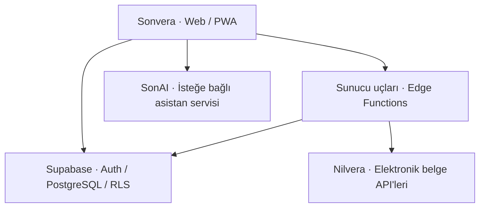

<div align="center">


# SONVERA
### İşletmenizin finansal iş akışları, tek bir yerde.


[](https://github.com/Semihkrks/sonvero/actions/workflows/check.yml)
[](LICENSE)
[](https://react.dev/)
[](https://supabase.com/)

[Başlangıç](#hızlı-başlangıç) · [Özellikler](#neler-yapabilirsiniz) · [Mimari](#sistem-nasıl-çalışır) · [Dokümantasyon](#dokümantasyon)

</div>

---

## Sonvera nedir?

**Sonvera**, Türkiye'deki işletmelerin elektronik belge, cari hesap ve tahsilat süreçlerini ortak bir arayüzde yönetmesi için geliştirilen açık kaynaklı bir muhasebe iş akışı uygulamasıdır. Faturaları incelemekten müşteri bakiyelerini takip etmeye, toplu tahsilat hazırlamaktan Excel raporu almaya kadar günlük operasyonları bir araya getirir.

| **50+ firma** | **200+ müşteri** | **Tek platform** |
| :---: | :---: | :---: |
| Gerçek işletme kullanımı | Günlük finansal iş akışları | Belgeler, hesaplar ve tahsilat |

**50'den fazla firma ve 200'den fazla müşterinin kullandığı Sonvera**, gerçek işletme ihtiyaçlarıyla geliştirilmektedir. Kullanım sayıları proje sahibinin bildirdiği uygulama kullanımını ifade eder; GitHub yıldızı veya bağımsız açık kaynak kurulumu ölçümü değildir.

## Neler yapabilirsiniz?

| Alan | Sonvera ile |
| :--- | :--- |
| **Elektronik belgeler** | Nilvera entegrasyonu üzerinden e-Fatura, e-Arşiv ve e-İrsaliye iş akışlarını yönetin; belge listeleri ve ayrıntılarına ulaşın. |
| **Cari hesaplar** | Müşteri bakiyelerini, cari hareketleri ve dönem bazlı hesap özetlerini inceleyin. |
| **Tahsilat** | Tahsilat kayıtlarını ve toplu dekont işlemlerini yönetin; eşleştirme sonuçlarını onaylayın. |
| **Excel ve PDF** | Finansal verileri dışa aktarın; belge ve tablo iş akışlarını tek arayüzden takip edin. |
| **SonAI** | Doğal dil ve sesle sayfalara erişin, cari bilgiler ve faturalar hakkında sorular sorun. İşlem sınırları [komut rehberinde](docs/sonai-voice-commands.md) açıklanır. |
| **Mobil kullanım** | Duyarlı arayüz, açık/koyu tema ve PWA altyapısıyla masaüstü ve mobil cihazlardan çalışın. |

> **Kurulum modeli:** Mevcut mimari, bir yetkili kullanıcının birden fazla firma hesabını yönetmesine odaklanır. Herkese açık çok kiracılı bir SaaS kurulumu için ek yetkilendirme ve izolasyon değerlendirmesi gerekir. Dağıtım durumu için [uygulama kaydını](docs/IMPLEMENTATION-STATUS.md) inceleyin.

## Sistem nasıl çalışır?



Tarayıcı arayüzü React ve Vite üzerinde çalışır. Kimlik doğrulama ve veriler Supabase/PostgreSQL ile yönetilir; hassas entegrasyon çağrıları sunucu tarafındaki kontrollü uçlardan geçer. Excel dışa aktarma gibi yoğun işlemlerde Web Worker kullanılır. SonAI servisi isteğe bağlıdır.

### Teknoloji altyapısı

| Katman | Teknolojiler |
| :--- | :--- |
| Arayüz | React 19, JavaScript / TypeScript, Vite, TanStack Query |
| Formlar ve doğrulama | React Hook Form, Zod, Decimal.js |
| Veritabanı ve kimlik | Supabase, PostgreSQL, RLS, Edge Functions |
| Dosya işlemleri | ExcelJS, SheetJS, pdf-lib, PDF.js, Web Workers |
| Kalite | Vitest, PGlite, Playwright, ESLint, TypeScript, GitHub Actions |
| Dağıtım | Vercel / Cloudflare yapılandırmaları, PWA |

## Hızlı başlangıç

### Gereksinimler

- **Node.js 22** ve npm
- İzole geliştirme için bir **Supabase projesi**
- Elektronik belge işlemleri için ilgili sağlayıcının test erişimi

```bash
git clone https://github.com/Semihkrks/sonvero.git
cd sonvero
npm ci
cp .env.example .env
npm run dev
```

Windows PowerShell'de `Copy-Item .env.example .env` kullanabilirsiniz.

`.env` dosyasını örneğe göre düzenleyin. `VITE_*` değişkenleri tarayıcıya açılır; bu alanlarda yalnızca herkese açık yapılandırma değerleri kullanın. Service-role anahtarları ve entegrasyon sırları sunucu tarafında kalmalıdır.

Arayüzün açılması, finansal işlemlerin kurulumunun tamamlandığı anlamına gelmez. Veritabanı, migration ve Edge Function hazırlığı için [dağıtım rehberini](docs/ROLLOUT.md) izleyin. Geliştirme ve testlerde sentetik veriler kullanın.

### Geliştirme komutları

| Komut | İşlev |
| :--- | :--- |
| `npm run dev` | Geliştirme sunucusu |
| `npm run lint` | Kaynak kodu kontrolleri |
| `npm run typecheck` | TypeScript denetimi |
| `npm run test` | Vitest testleri |
| `npm run build` | Üretim derlemesi |
| `npm run check` | Tip denetimi + testler + derleme |
| `npm run test:e2e` | Playwright tarayıcı testleri |

CI ayrıca ilgili Supabase fonksiyonlarını Deno ile denetler. Güncel adımlar [.github/workflows/check.yml](.github/workflows/check.yml) içindedir.

## Proje yapısı

| Dizin | İçerik |
| :--- | :--- |
| `src/` | Arayüz, sayfalar, servisler ve worker'lar |
| `supabase/` | Migration'lar, veritabanı doğrulaması ve Edge Functions |
| `services/assistant/` | SonAI asistan servisi |
| `tests/` | Birim, entegrasyon ve tarayıcı senaryoları |
| `scripts/` | Yedekleme, ölçüm ve dağıtım yardımcıları |
| `docs/` | Kurulum, mimari notları ve bakım rehberleri |
| `public/` | Herkese açık statik varlıklar |

## Dokümantasyon

- [Dağıtım ve migration sırası](docs/ROLLOUT.md)
- [Uygulama durumu](docs/IMPLEMENTATION-STATUS.md)
- [Yedekleme ve geri yükleme](docs/BACKUP-RESTORE.md)
- [Performans ölçümleri](docs/PERFORMANCE.md)
- [SonAI sesli komutları](docs/sonai-voice-commands.md)

## Katkıda bulunun

Hata düzeltmeleri, kurulum rehberi iyileştirmeleri, erişilebilirlik çalışmaları ve regresyon testleri memnuniyetle karşılanır. Büyük bir değişiklikten önce bir issue açarak kapsamı konuşun. Hata bildirimlerinde gerçek müşteri kayıtları yerine sentetik örnekler kullanın.

Güvenlik açıklarını, kimlik doğrulama sırlarını veya finansal kayıtları herkese açık issue'larda paylaşmayın. Önceden kaydedilmiş hassas dosyaların son sürümden kaldırılması Git geçmişini temizlemez; geçmiş ve dağıtım kopyaları ayrıca değerlendirilmelidir.

## Lisans

Özgün proje materyalleri **MIT Lisansı** ile sunulur. Üçüncü taraf servisler, bağımlılıklar, markalar ve veri setleri kendi koşullarına tabidir. Sonvera bağımsız bir projedir; Nilvera'nın resmî ürünü değildir.

<details>
<summary><strong>English overview</strong></summary>

Sonvera is open-source accounting workflow software for Turkish businesses, bringing electronic invoicing, current accounts, collections, financial exports and an optional conversational assistant into one interface.

The maintainer reports application use by **more than 50 companies and 200 customers**. These figures describe application usage, rather than GitHub popularity or independently verified open-source installations. The architecture primarily supports one authorized owner managing multiple company accounts.

Built with React, Vite and Supabase/PostgreSQL, with controlled server-side e-document integrations. Review rollout, implementation status and security documentation before deployment.

</details>

---

<div align="center"><strong>Sonvera</strong> · Türkiye'deki işletmelerin günlük ihtiyaçlarından doğdu.</div>
